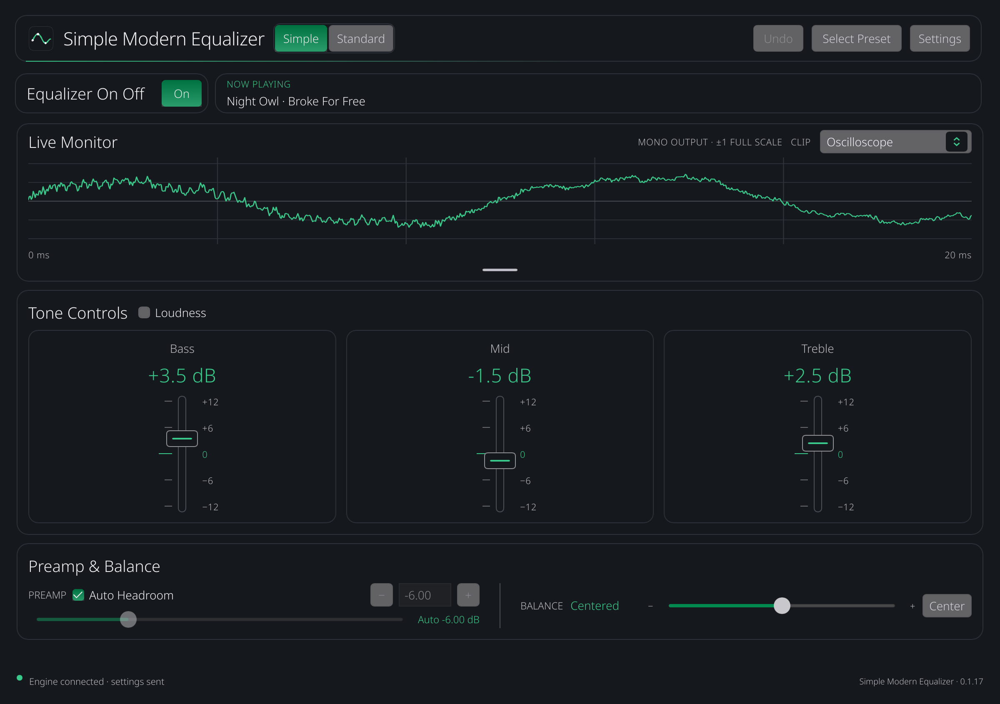
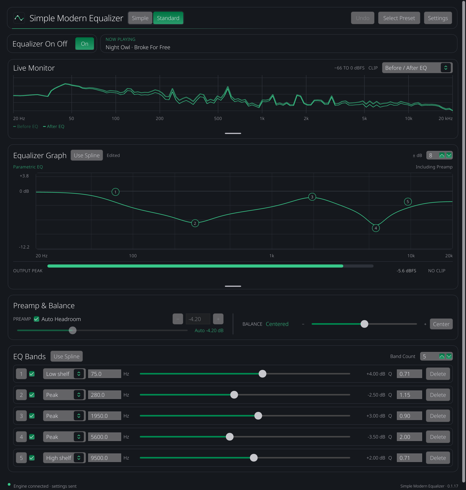

# Simple Modern Equalizer for Linux and Windows

Simple Modern Equalizer is a free, open-source system-wide EQ for headphones and speakers. On Linux it uses PipeWire to equalize audio from your apps. Load a headphone preset, adjust bass, midrange, and treble in **Simple**, or shape a parametric EQ or spline curve in **Standard**.

[Linux downloads](#downloads) · [Try a headphone preset](#try-a-headphone-preset) · [Windows installer](#windows-x64-installer) · [Build from source](#build-from-source)

## Install on Linux

### Downloads

Published versions appear on [GitHub Releases][releases] with public downloads. You can also sign in to GitHub to download the v0.1.16 build for your system below.

| Linux x86-64 | Download |
| --- | --- |
| AppImage | [Download AppImage][appimage-download] |
| Fedora 44 | [Download RPM][fedora-download] |
| Ubuntu 24.04 | [Download Ubuntu DEB][ubuntu-download] |
| Debian 13 | [Download Debian DEB][debian-download] |

For Flatpak, see [Install the Flatpak bundle](#flatpak). For newer builds, check the [installer workflow runs][installer-builds] or [build from source](#build-from-source).

### Flatpak

Get `Simple-Modern-Equalizer-x86_64.flatpak` from a [GitHub release][releases] that includes the bundle, or [build it locally](#build-from-source). From the folder containing the bundle, run these commands.

```sh
flatpak install --user ./Simple-Modern-Equalizer-x86_64.flatpak
flatpak run io.github.m757_0815.simple-modern-equalizer
```

The bundle needs a running PipeWire session and the Freedesktop 26.08 runtime. The installer offers to fetch the runtime from Flathub. Update the app by installing a newer bundle.

### Linux AppImage

The AppImage needs a running PipeWire session. Open a terminal in the download folder and run these commands.

```sh
chmod +x Simple-Modern-Equalizer-x86_64.AppImage
./Simple-Modern-Equalizer-x86_64.AppImage
```

AppImages built on Fedora 44 require glibc 2.43 or later.

### Fedora 44 RPM

Run `sudo dnf install ./FILE.rpm` with the downloaded filename, then open **Simple Modern Equalizer** from the application menu.

### Ubuntu 24.04 and Debian 13 packages

Run `sudo apt install ./FILE.deb` with the downloaded filename, then open **Simple Modern Equalizer** from the application menu.

## Try a headphone preset

1. Play a familiar track. Under **Settings → Playback → Output device**, choose the output your headphones use or keep **Follow system default**.
2. Open **Select Preset** and choose a tuning for your headphones. Choose **Flat** to start with a neutral curve.
3. Adjust **Bass** or **Treble** in **Simple**. In **Standard**, drag a point up or down to change its gain or sideways to change its frequency.
4. Use the equalizer’s **On / Off** switch while the track is playing to hear the difference.

| Simple tone controls | Standard EQ with before / after monitoring |
| --- | --- |
| [](docs/screenshots/simple.png) | [](docs/screenshots/standard.png) |

## Windows x64 installer

Sign in to GitHub to [download the v0.1.16 MSI][windows-download]. Uninstall Resonance first, then run `SimpleModernEqualizer-Setup-x64.msi` and open the app from Start. The development MSI registers an unsigned audio component, sets `DisableProtectedAudioDG`, and restarts Windows Audio.

## Equalizer features

- **Tone controls.** The **Simple** view gives you Bass, Mid, Treble, and Loudness. Double-click a lever to reset it. Both modes share **Preamp & Balance**. Enabling **Auto Headroom** replaces the manual preamp gain with a calculated value.
- **Parametric EQ and spline editing.** In **Standard**, drag EQ handles, hold **Shift** for fine adjustment, and double-click to add a handle. Set the graph range in the upper right from **±1 dB** to **±24 dB**. At ±1 dB, moving through half the graph height adjusts gain by 1 dB. Right-click a band or interior spline point to remove it. **Use Spline** and **Use Parametric** fit the same reference curve. **Optimizing EQ curve…** appears while a fit runs. **Undo** keeps the last 15 EQ actions.
- **Headphone presets and Equalizer APO import.** Use the included tunings for headphones such as the Beyerdynamic DT 770 PRO, or save your own. **Select Preset** links presets to an audio output and imports Equalizer APO `.txt` files. Loading or importing asks before replacing unsaved EQ changes. [Headphone preset catalog](presets/catalog.json)
- **Live audio monitoring.** **Live Monitor** offers six views, including Before / After EQ on PipeWire. Use **Settings** to choose an output. Native Linux installations also offer **Start on login**. [Audio output settings screenshot](docs/screenshots/settings.png)
- **Now Playing.** Shows the current song and artist from the system media session.

## Build from source

Use the pinned Rust toolchain and install the platform dependencies listed in the build workflow. The app uses a Slint UI and the vendored Resonance audio engine. [Toolchain](rust-toolchain.toml) · [Build workflow](.github/workflows/package.yml) · [UI](ui/main.slint) · [Engine](vendor/resonance)

```sh
cargo test --locked -j 2
sh scripts/build-linux.sh
./dist/linux/simple-modern-equalizer
```

| Package | Build command |
| --- | --- |
| [Linux AppImage](scripts/build-appimage.sh) | `sh scripts/build-appimage.sh` |
| [Linux Flatpak](scripts/build-flatpak.sh) | `sh scripts/build-flatpak.sh` with Flatpak and Flatpak Builder installed |
| [Ubuntu or Debian package](scripts/build-deb.sh) | `sh scripts/build-deb.sh` on the target distribution |
| [Fedora RPM](scripts/build-fedora.sh) | `sh scripts/build-fedora.sh` |
| [Windows MSI](scripts/build-windows.ps1) | `./scripts/build-windows.ps1` |

Local installer builds are in `dist/`. The [v0.1.16 source archive][source-download] is also available as a GitHub Actions download.

To publish a release, tag a commit on `main` with a new version such as `v0.1.17` and push the tag. The workflow publishes the packages to [GitHub Releases][releases] once all builds pass. Manual runs produce workflow artifacts for testing.

Windows builds need MSVC, a Windows SDK, and WiX 4 with its Util extension. Enable EQ and pause playback before running the Windows audio check. [Audio check script](scripts/test-windows-audio.ps1)

To contribute a headphone preset, add your tuning with the model, impedance, and source, then run `cargo test --locked bundled_catalog`.

## License

Source is GPL-3.0-or-later. Builds using Slint’s GPL option are distributed under GPLv3. [License](LICENSE) · [Third-party notices](THIRD_PARTY_NOTICES.md)

[appimage-download]: https://github.com/m757-0815/Simple-Modern-Equalizer/actions/runs/45635934436/artifacts/15034031057
[fedora-download]: https://github.com/m757-0815/Simple-Modern-Equalizer/actions/runs/45635934436/artifacts/15034451215
[ubuntu-download]: https://github.com/m757-0815/Simple-Modern-Equalizer/actions/runs/45635934436/artifacts/15033398006
[debian-download]: https://github.com/m757-0815/Simple-Modern-Equalizer/actions/runs/45635934436/artifacts/15032949515
[windows-download]: https://github.com/m757-0815/Simple-Modern-Equalizer/actions/runs/45635934436/artifacts/15033243574
[source-download]: https://github.com/m757-0815/Simple-Modern-Equalizer/actions/runs/45635934436/artifacts/15033360114
[installer-builds]: https://github.com/m757-0815/Simple-Modern-Equalizer/actions/workflows/package.yml
[releases]: https://github.com/m757-0815/Simple-Modern-Equalizer/releases
