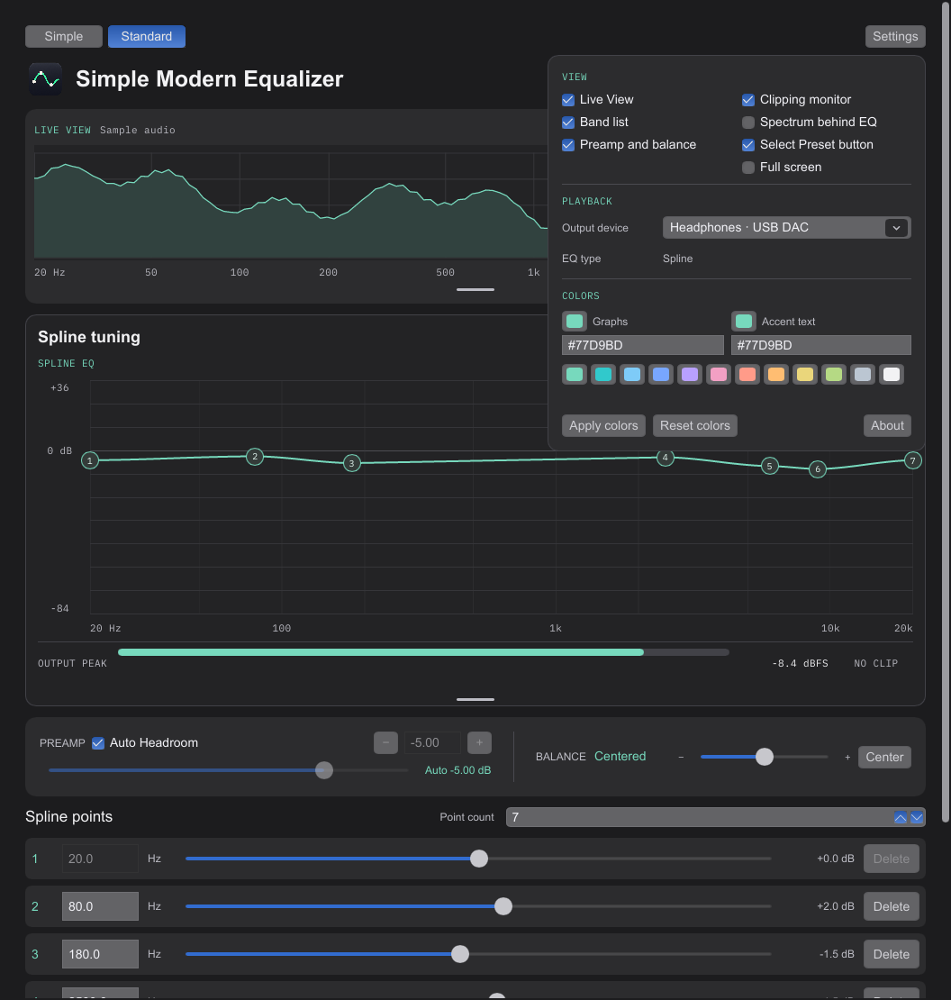

# Simple Modern Equalizer

Simple Modern Equalizer is a system-wide equalizer for Linux and Windows. Tune the sound of your music, games, and videos from one app.

- **Linux and Windows.** Get the same controls on both platforms, with a Linux AppImage and Fedora RPM alongside the Windows installer.
- **Open source.** Read the code, build it yourself, or share your own headphone presets. [GPL-3.0-or-later](LICENSE)
- **Easy to use.** Start with Bass, Mid, and Treble, choose a headphone preset, or drag points on the EQ curve for finer control.
- **Modern design.** A dark interface with customizable colors, resizable graphs, and live meters.
- **Fast and lightweight.** Audio processing runs locally. Live View pauses when hidden, and idle graphs skip unnecessary redraws.


## Start listening

1. Install the Windows MSI, open the Linux AppImage, or install the Fedora RPM with your software manager.
2. Start playing audio. Open **Settings** to check the output device. On Linux, the app uses your desktop’s PipeWire session.
3. Pick **Simple** for Bass, Mid, Treble, and Loudness. Double-click a lever to reset it. Pick **Standard** for the EQ graph, preamp, and stereo balance.
4. Open **Select Preset** for Beyerdynamic DT 770 and DT 990 starting points, or choose **Save as Preset** to keep your own tuning.


## Shape the sound

- In **Standard**, start with **Flat** for a spline EQ. Drag a point to shape the sound around it while the other points stay fixed. The 20 Hz and 20 kHz endpoints move vertically to change gain. Double-click the graph to add a point or use **Delete** on its row. Manual preamp ranges from −12 to +12 dB. Manual preamp and Auto Headroom shift the dB scale while the curve and its points stay in place. Edit parametric presets using the band controls or select **Use spline** under **Settings → EQ type** to turn enabled bands into spline points.
- Choose Analog VU, Spectrum, Bars, Oscilloscope, or Stereo Level from the dropdown in **Live View**. The bar spectrum adapts to the view width with up to 512 bands. Stereo Level shows separate left and right RMS levels in dBFS. Drag the bottom grip to resize either graph. The EQ graph stays visible in **Standard** and can extend below the window. Scroll down to reach its grip again. Use **Settings** to show or hide optional panels or switch to full screen. Press **Esc** to exit full screen.
- Under **Settings → Colors**, click a swatch to open its color wheel, adjust brightness, or enter RGB, HSV, or hex values. Both default to mint. **Apply colors** saves them immediately.
- The **Enable Equalizer** box turns EQ and balance on or off in either layout. **Auto Headroom**, beside Loudness in Simple and Preamp in Standard, lowers the gain when boosts could cause clipping. During a clip, Simple highlights the dominant tone ranges in red, and Standard marks them on the EQ graph.
- Save, rename, or overwrite your own presets from **Select Preset**. You can link a preset to a particular output, such as a USB DAC.



On Windows, the development installer registers an unsigned audio component, sets `DisableProtectedAudioDG`, and restarts Windows Audio. It shares a component ID with Resonance and cannot be installed alongside it. The AppImage targets recent x86-64 PipeWire desktops. The RPM is built on Fedora 44. See [third-party notices](THIRD_PARTY_NOTICES.md).

### Test the Windows audio driver

Enable the equalizer, pause other playback, and run this from the repository in PowerShell.

```powershell
powershell -NoProfile -ExecutionPolicy Bypass -File .\scripts\test-windows-audio.ps1
```

The test plays three quiet tones through the default output. It passes when fresh callbacks from the enabled APO follow the tone levels in the same Windows audio engine process. Exit code 0 means the test passed. A failure includes the number of callbacks observed during each tone. The test leaves your preset and volume settings unchanged.

## Contribute a preset

1. Tune your headphones in **Standard**, then choose **Select Preset → Save as Preset**. Name it with the manufacturer, exact model, and impedance where it applies, such as **Beyerdynamic DT 990 PRO - 250 ohms**.
2. Find the saved JSON under `%LOCALAPPDATA%\SimpleDarkEQ\presets` on Windows or `~/.config/simpledarkeq/presets` on Linux. If you set `XDG_CONFIG_HOME`, look under `$XDG_CONFIG_HOME/simpledarkeq/presets`.
3. Open a pull request adding the saved preset object to [presets/catalog.json](presets/catalog.json). Fill in `description` with the intended sound and how you tested it. In the pull request, include the exact headphone variant and your tuning or measurement method.
4. Submit your own tuning under the [project license](LICENSE). If it uses third-party filters or measurement data, include the source, author, license, and required credits. Check that the terms allow inclusion and redistribution with the project.

If you have a local build, run `cargo test --locked bundled_catalog` to validate the catalog and select the preset in the app to check it.

## Build and contribute

In GitHub, open **Actions → Build installers → Run workflow** to build the x64 Windows installer, Linux AppImage, Fedora RPM, and matching source archive. Pushing a `v*` tag also starts the workflow. Download the artifacts from the completed run.

Locally, use the pinned Rust toolchain and run `cargo test --locked`. Windows packaging needs MSVC, a Windows SDK, and WiX 4 with its Util extension. Linux packaging needs the PipeWire development headers, Clang, and the desktop libraries listed in the workflow.

| Area | Where to start |
| --- | --- |
| Layout, menus, and controls | [ui/main.slint](ui/main.slint) |
| UI actions and app state | [src/main.rs](src/main.rs) |
| Bands, presets, and JSON/APO compatibility | [src/config.rs](src/config.rs), [src/presets.rs](src/presets.rs) |
| System audio, spline filter, and output capture | [src/engine.rs](src/engine.rs), [src/spline.rs](src/spline.rs), [src/scope.rs](src/scope.rs), [vendor/resonance](vendor/resonance) |
| Graph, live displays, and spectrum analysis | [src/graph.rs](src/graph.rs), [src/live.rs](src/live.rs), [src/spectrum.rs](src/spectrum.rs) |
| Installers and automated builds | [scripts](scripts), [packaging](packaging), [GitHub workflow](.github/workflows/package.yml) |

For an audio bug, include your OS, playback device, and the connection status shown in the app.

Copyright © 2026 Simple Modern Equalizer contributors. Project source is GPL-3.0-or-later. Builds using Slint’s GPL option are distributed under GPLv3. Read the full license under **Settings → About**, or see [LICENSE](LICENSE) and [third-party notices](THIRD_PARTY_NOTICES.md).
